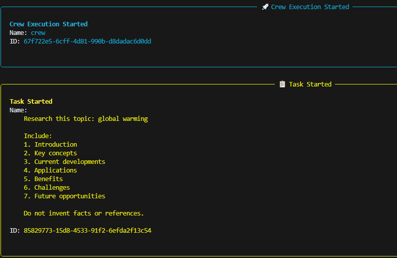
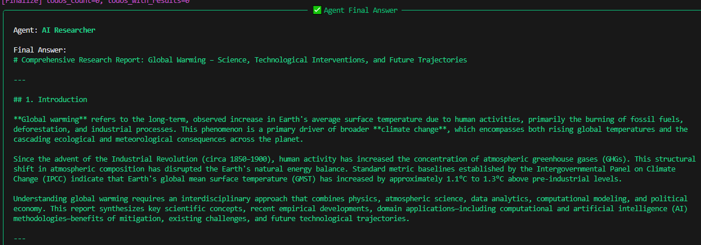
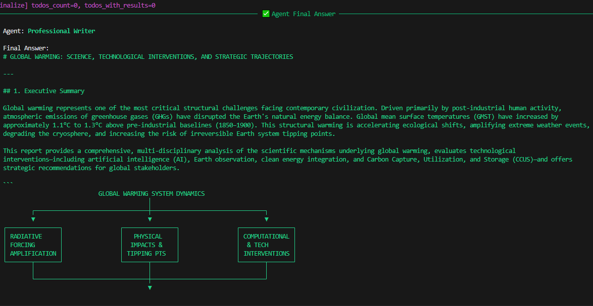
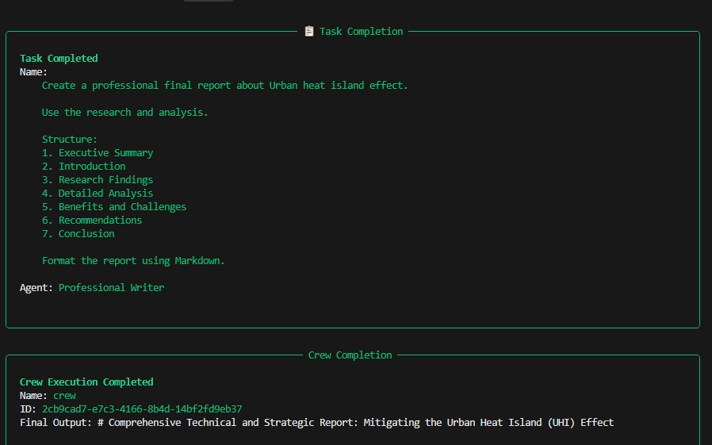
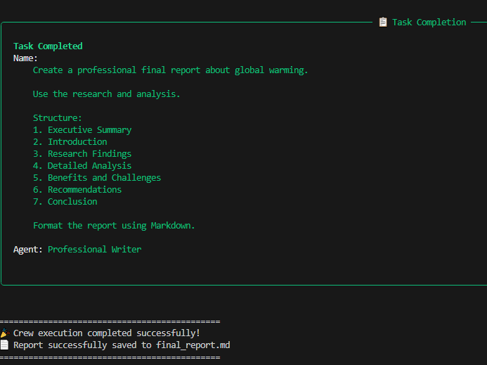

# CREW AI - Multi-Agent Research Assistant
An autonomous multi-agent system powered by CrewAI and Google Gemini.
Three specialized AI agents work together to research, analyze, and  generate professional Markdown reports automatically. 

## How It Works

| Agent | Role |
| :--- | :--- |
| **AI Researcher** | Researches the topic and gathers accurate information |
| **Research Analyst** | Analyzes findings, risks, and opportunities |
| **Professional Writer** | Creates the final professional report in Markdown |

Process: `Research → Analysis → Writing` (Sequential)

## Screenshots

### Crew Execution


### Research Agent - Final Answer


### Professional Writer Agent


### Task Completion


### Task - Final Report



## Features

- Multi-agent collaboration with CrewAI
- Powered by Google Gemini
- Automatic retry (up to 3 attempts) on API failure
- Clean Markdown report output
- No invented facts or references

## Project Structure
```
CREW AI/
├── app.py              # Main application
├── requirements.txt    # Dependencies
├── .env                # Your API key (not uploaded to GitHub)
├── .env.example        # Example env file
├── final_report.md     # Generated report
└── images/             # Screenshots
```
## Setup
```
1. Clone the project

  git clone https://github.com/MaryamArif85/Crew-AI-Multi-Agents
  cd "CREW AI"

2. Create virtual environment
  python -m venv venv
  venv\Scripts\activate

3. Install dependencies
  pip install -r requirements.txt

4. Add your API key
  Create a .env file:
  envGEMINI_API_KEY=your_api_key_here
  Get your key from: aistudio.google.com

 5. How to Run
  python app.py
  Then enter your topic when asked:
   Enter your research topic: Artificial Intelligence in HealthcareOutput

   After completion, you will see:

   🎉 Crew execution completed successfully!
   📄 Report successfully saved to final_report.mdOpen final_report.md to read your full report.
```
### Example Topics
```
Artificial Intelligence in Healthcare
Future of Electric Vehicles
Blockchain in Finance
Climate Change and Technology
```

### Technologies Used
```
Python
CrewAI
Google Gemini (gemini-3.6-flash)
LiteLLM
python-dotenv
```
